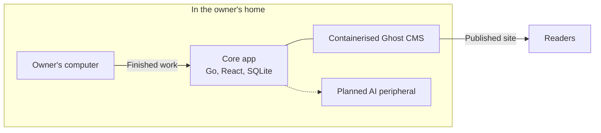

# Architecture

This is a high-level description of how Autarks' Home is put together. It is not a specification of the private codebase, and it omits security internals, hosting details and operational configuration.

## Stack

The Core app — the setup wizard, the owner dashboard and the management of publications — is a Go backend with a React frontend. Appliance state is stored in SQLite, so the box does not depend on an external database server. The first CMS is containerised Ghost. The reference hardware is ARM64, today a Raspberry Pi 5.

Go was chosen so that the Core app can be a single, compact binary, easy to cross-compile for ARM64, and a good fit for a quiet home appliance that is meant to "just work".

## Components

- **The appliance.** A plug-and-play box in the home or office. The owner should not need to administer a server.
- **The Core app.** Onboards the owner, presents a simple owner view by default, and provides an admin view for infrastructure and (later) additional app-management controls. It provisions and manages a containerised CMS for each publication.
- **The CMS.** Containerised Ghost holds the publication: drafts, published articles, graphics and formatting. Public addresses identify the publication, not the software underneath, so a later change of CMS need not change a public URL.
- **The owner's own computer.** Writing happens here, in tools the owner already knows. Finished work is sent to the appliance, saved as a draft, and published when the author is ready.
- **A planned AI peripheral.** Not built. A later add-on for affordable local inference, with research and paper-publishing applications. Raw data is intended to stay in the home.

Hardware security keys and passkeys are planned before invited beta. They are not built yet.

## How work flows

At a conceptual level:

1. The owner sets the appliance up through the setup wizard (planned: its first stage is in place, and the rest is being built).
2. The Core app creates a publication and provisions its CMS.
3. The owner writes on their own computer and sends the finished piece to the appliance.
4. The Core app places it in the CMS as a draft. The author reviews it and publishes.
5. Readers see the published site. The appliance, not a rented platform, is the host.

The dashed connection to the AI peripheral marks work that is planned, not built.
