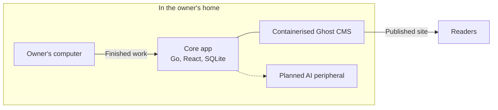

# Design

This page describes the design of Autarks' Home: how the appliance is meant to work. It does not say what has been built so far. The website does that, at [autarks-home.com](https://autarks-home.com).

It is a public slice of the design. Internal security design, operational configuration and unfinished private specifications are omitted.

## Goals

Autarks' Home is a self-hosted, plug-and-play content management appliance for authors, independent creators, crafters, small businesses, local councils, and anyone who values independence, self-sufficiency and personal agency. One box, no server administration required, on which an owner can run their own site.

The longer aim is a digital home people can own, run and govern: publishing they control and, with a planned add-on, affordable local AI, without depending on a platform company or rented APIs.

## Principles

**The interface is the product.** The appliance only makes sense if "no technical skill required" is true in practice, at every step. A feature that cannot be made simple and clear in the interface is not ready to ship, regardless of backend readiness. The interface is one design system: a simple owner view by default, with an admin view underneath for infrastructure and, later, additional controls.

**Preserve "it just works".** Every future feature must be deliverable without compromising the plug-and-play promise. A feature that needs per-installation vendor intervention, infrastructure the owner cannot manage, or specialised technical setup is not ready to ship until it can be delivered in a way that still "just works". Uncertain ideas belong on a research list, not in the committed feature set.

**Public addresses identify publications, not software.** Switching CMS must never require a public URL to change.

**The owner does two jobs.** One is familiar: running a publication, which means telling a story, showing work and serving readers. The other is less familiar: owning an appliance that should protect itself but still has to be looked after. First setup is honestly a short appliance job. Once a publication exists, day-to-day work should feel like publishing, with appliance management available when it is needed, and status always visible so the owner can look even when nothing is wrong.

**If the company disappears, owners lose nothing.** Firmware and OS builds will be documented and published, and keys and backups stay in the owner's possession, so anyone can rebuild and maintain the system. What is open source, and what is not, is set out in the [README](../README.md).

## Stack

The Core app (the setup wizard, the owner dashboard and the management of publications) is a Go backend with a React frontend. Appliance state is stored in SQLite, so the box does not depend on an external database server. The first CMS is containerised Ghost. The reference hardware is ARM64, today a Raspberry Pi 5.

Go was chosen so that the Core app can be a single, compact binary, easy to cross-compile for ARM64, and a good fit for a quiet home appliance that is meant to "just work".

## Components

- **The appliance.** A plug-and-play box in the home or office. The owner should not need to administer a server.
- **The Core app.** Onboards the owner, presents a simple owner view by default, and provides an admin view for infrastructure and, later, additional controls. It provisions and manages a containerised CMS for each publication.
- **The CMS.** Containerised Ghost holds the publication: drafts, published articles, graphics and formatting.
- **The owner's own computer.** Writing happens here, in tools the owner already knows. Finished work is sent to the appliance, saved as a draft, and published when the author is ready.
- **A planned AI peripheral.** A later add-on for affordable local inference, with research and paper-publishing applications. Raw data is intended to stay in the home.

Sign-in by hardware security key and passkey is planned, as a choice for the owner and not a requirement.

## How work flows

1. The owner sets the appliance up through a setup wizard.
2. The Core app creates a publication and provisions its CMS.
3. The owner writes on their own computer and sends the finished piece to the appliance.
4. The Core app places it in the CMS as a draft. The author reviews it and publishes.
5. Readers see the published site. The appliance, not a rented platform, is the host.

The dashed connection marks the AI peripheral as a later addition.

## The owner's journeys

**First setup.** The owner powers the appliance on and is guided by a setup wizard. The aim is a short, confidence-inspiring first boot, not a lesson in server administration.

**Creating a publication.** The owner creates a site or publication by name. The Core app provisions a containerised CMS for it. The owner is not asked to think in terms of containers or infrastructure.

**Writing and publishing.** The default path is writer-first. The author writes on their own computer, in tools they already know, and sends the finished work to the appliance. It is saved as a draft in the CMS, complete with graphics and custom formatting, and the author publishes when ready.

**Day-to-day use and looking after the box.** Day-to-day publishing is meant to stay in a simple owner view. Structural or administrative actions belong in a distinct admin view. The owner should always be able to see the appliance's status, including backups, even when nothing is flagged.

**Joining or founding a guild.** Once a reliable appliance is in an owner's home, it can join another appliance, or a group of appliances, as a guild node.

## Guilds

Every Autarks' Home appliance is a node in its own right. It does not have to join anything to be useful.

Beyond that, an appliance can join another appliance, or a group of appliances, as a guild node, and its owner thereby becomes a guild member. Whoever forms a guild (the founders, and in due course a board of governors) sets the rules for membership, governance and any fees. Membership fees, if any, are for each guild to decide, not for Autarks' Home to levy. Autarks' Home's role is that of an administrative tool. An appliance is not limited to one guild, so an owner can be a member of any number of guilds at once.

While a guild has few members, the management system may run on a founder's own node; as it grows, members might set up a dedicated node for a guild manager.

Guilds are the step from individual autarky to community. A guild could be individuals forming a club, a group of machine shops with complementary fabrication systems and skills, a parish council, a library, a co-op or a book publisher. One possibility being explored is sharing idle compute among guild nodes.

## Two commercial modules

Two later modules are separate commercial products, outside the open-source commitment. The open appliance, the AI engine and the Research Workbench do not depend on either and are usable without them.

- **Guild management:** the software a guild uses to manage its membership, governance and fees.
- **Data modeling:** a general-purpose tool for designing and maintaining models of an owner's or a group's own data, in any subject, so that a local AI can work on it, with AI assisting in the modeling.

## The planned AI peripheral

The design includes a peripheral AI compute engine for the appliance, with:

- applications for technical and scientific research, and a way to publish papers;
- software that stretches modest hardware;
- an open buyer's blueprint, with compute-per-pound and per-watt benchmarks, so owners can choose a configuration they can afford;
- a modest, exploratory test of federated adaptation across mixed, intermittently connected home appliances, aiming for privacy guarantees explained in plain language. Raw data stays in the home.

Which of this is proposed to a funder is set out in the [roadmap](../ROADMAP.md).
